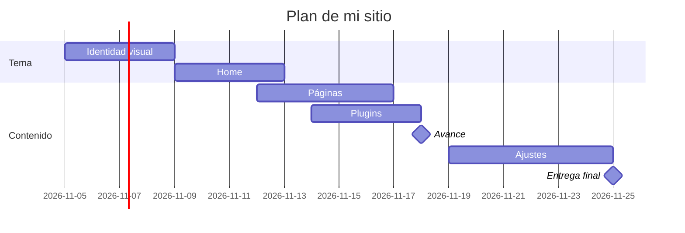

# Plantilla: `decisiones.md`

Copia este contenido en un archivo `decisiones.md` en la raíz de tu repo y complétalo. Es la **Sumativa 2** (25 pts), y en el avance (18 nov) lo corriges. Sin informe largo.

---

# Decisiones de mi sitio

**Emprendimiento:** (nombre)
**Fecha:** (fecha de entrega) · **Última corrección:** (fecha)

## 1. Plugins (10 pts)

Al menos **5 plugins**, cada uno vale 2 pts. **SEO** y **contacto** son obligatorios; los otros 3 los eliges según lo que necesita tu sitio (parte de `docs/03-funcionalidades.md`). Guía: `guia-investigar-plugins.md`.

| # | Funcionalidad | Plugin | Gratis o de pago | Qué incluye la versión gratis | Probado hasta (WP) | Requiere PHP | ¿Funciona con tema propio? | Enlace a la ficha |
|---|---|---|---|---|---|---|---|---|
| 1 | SEO (obligatorio) | | | | | | | |
| 2 | Contacto (obligatorio) | | | | | | | |
| 3 | | | | | | | | |
| 4 | | | | | | | | |
| 5 | | | | | | | | |

## 2. Páginas de la fase 1 (5 pts)

**5 páginas**, 1 pt cada una. **Inicio** y **Contacto** son obligatorias; las otras 3 las eliges (no pueden ser del carro de compras).

| # | Página | Por qué la elijo (una línea) |
|---|---|---|
| 1 | Inicio (obligatoria) | |
| 2 | Contacto (obligatoria) | |
| 3 | | |
| 4 | | |
| 5 | | |

**Páginas que dejo para después:** (lista corta)

## 3. Plan del tema (5 pts)

- **Nombre del tema:**
- **Custom o descargado:** (y por qué, en una línea)
- **Carta Gantt** del desarrollo del sitio (5 al 25 de noviembre). Puedes usar esta tabla o un diagrama Mermaid.

| Etapa | Desde | Hasta | Notas |
|---|---|---|---|
| Identidad visual | | | |
| Home | | | |
| Páginas | | | |
| Plugins | | | |
| **Avance (18 nov)** | | 18 nov | |
| Ajustes y formulario | | | |
| **Entrega final (25 nov)** | | 25 nov | |

Ejemplo con Mermaid (GitHub lo muestra como gráfico):

````

````

## 4. Plan B (5 pts)

Qué hago si algo no funciona. **Al menos 3 riesgos**, cada uno con su mitigación y cuándo se activa.

| Riesgo | Qué hago | Cuándo se activa (fecha o señal) |
|---|---|---|
| El tema propio no funciona o se rompe | | |
| Un plugin falla o no es compatible | | |
| | | |

## Cambios respecto de la Sumativa 2 (solo en el avance del 18 nov)

| Qué cambié | Qué había antes | Por qué | Evidencia (captura o commit) |
|---|---|---|---|
| | | | |

**Decisión:** (continúo con mi propuesta / pivoteo, y por qué)
