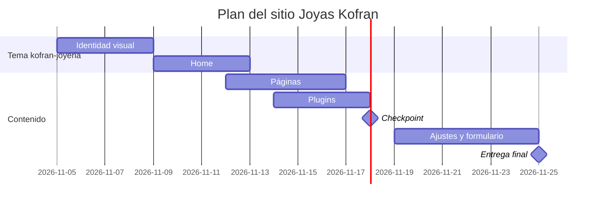

# Decisiones de mi sitio

**Emprendimiento:** Joyas Kofran — joyas de plata ley 925 con 6 meses de garantía
**Fecha:** 4 de noviembre de 2026 · **Última corrección:** —

## 1. Plugins (10 pts)

Datos revisados en la ficha oficial de cada plugin en wordpress.org el 3 de noviembre de 2026. Las funcionalidades salen de `docs/03-funcionalidades.md` de mi repo [mi-emprendimiento](https://github.com/Andreiro2/mi-emprendimiento).

| # | Funcionalidad | Plugin | Gratis o de pago | Qué incluye la versión gratis | Probado hasta (WP) | Requiere PHP | ¿Funciona con tema propio? | Enlace a la ficha |
|---|---|---|---|---|---|---|---|---|
| 1 | SEO (obligatorio): que Camila llegue desde Google a los artículos del blog | Yoast SEO | Gratis, con versión Premium de pago | Análisis de contenido, título SEO y meta descripción, schema, mapa del sitio XML y URL canónicas | 7.1.3 | 7.4 o superior | Sí: trabaja desde el panel y escribe en `wp_head()`, que la plantilla base trae | [wordpress-seo](https://wordpress.org/plugins/wordpress-seo/) |
| 2 | Contacto (obligatorio): dejar sus datos para recibir asesoría o novedades (captación de leads) | Contact Form 7 | Gratis (código abierto, sin versión de pago) | Formularios ilimitados que se insertan con un bloque o un shortcode | 7.1.4 | 8.3 o superior (y WordPress 7.1 o superior) | Sí: el formulario se pega en la página Contacto con su bloque o shortcode | [contact-form-7](https://wordpress.org/plugins/contact-form-7/) |
| 3 | Consultar por WhatsApp sobre una pieza sin tener que explicar cuál estaba viendo | Joinchat | Gratis, con Joinchat Premium y Joinchat AI de pago | Botón flotante de WhatsApp que abre la app en el celular y WhatsApp Web o un QR en el computador | 7.1.3 | 7.0 o superior | Sí: el botón se agrega con `wp_footer()`, que la plantilla base trae | [creame-whatsapp-me](https://wordpress.org/plugins/creame-whatsapp-me/) |
| 4 | Compartir un artículo en WhatsApp y redes sociales | AddToAny Share Buttons | Gratis | Botones para compartir en WhatsApp, Facebook, Pinterest y muchas redes más; antes o después del contenido, barra flotante, shortcode o widget | 7.0.8 | 5.6 o superior | Sí: se agrega solo al contenido de las entradas o con shortcode | [add-to-any](https://wordpress.org/plugins/add-to-any/) |
| 5 | Respaldar el sitio para poder reinstalarlo en otro servidor (objetivo del proyecto) | BackWPup | Gratis, con BackWPup Pro de pago | Respaldo completo de base de datos y archivos, programado de cada hora a cada mes, varios destinos y restauración desde un respaldo subido a mano | 7.1.4 | 7.4 o superior | Sí: no depende del tema, respalda los archivos y la base de datos | [backwpup](https://wordpress.org/plugins/backwpup/) |

**Descartado:** Akismet (filtro de spam). Es gratis solo para blogs personales; un sitio comercial como Joyas Kofran necesita una suscripción de pago. Los comentarios del blog quedaron como funcionalidad «Futuro».

## 2. Páginas de la fase 1 (5 pts)

| # | Página | Por qué la elijo (una línea) |
|---|---|---|
| 1 | Inicio (obligatoria) | Es la landing: presenta la marca, la garantía y lleva a la tienda, al blog y a WhatsApp. |
| 2 | Contacto (obligatoria) | Responde a la funcionalidad imprescindible de captar datos para asesoría y novedades. |
| 3 | Blog | Es la puerta de entrada desde Google del flujo de contenido y ya tiene 3 entradas publicadas. |
| 4 | Garantía y autenticidad | Responde a la funcionalidad imprescindible de verificar que la pieza es plata ley 925 y conocer la garantía de 6 meses. |
| 5 | Preguntas frecuentes | Reúne en un lugar las dudas de Camila sobre despacho, cambios, tallas y cuidado de la plata. |

**Páginas que dejo para después:** Tienda, categorías de productos, ficha de producto y carrito (la tienda queda fuera de la fase 1), Guía de tallas, Despacho y cambios, Términos y condiciones, Política de privacidad y 404.

## 3. Plan del tema (5 pts)

- **Nombre del tema:** `kofran-joyeria`
- **Custom o descargado:** Custom, a partir de `tema-base/`, para reconstruir mi prototipo de Stitch con mi paleta (azul #1F4E79) y mis fuentes (Playfair Display y Plus Jakarta Sans).
- **Carta Gantt** del desarrollo del sitio (5 al 25 de noviembre):

| Etapa | Desde | Hasta | Notas |
|---|---|---|---|
| Identidad visual | 5 nov | 8 nov | Copio `tema-base/` a `proyecto/kofran-joyeria/`, cargo logo, colores y fuentes en `style.css`, header y footer |
| Home | 9 nov | 12 nov | `front-page.php` según el prototipo de Stitch |
| Páginas | 12 nov | 16 nov | Contacto, Blog, Garantía y autenticidad, Preguntas frecuentes |
| Plugins | 14 nov | 17 nov | Instalo y configuro Yoast SEO, Contact Form 7, Joinchat, AddToAny y BackWPup |
| **Checkpoint (18 nov)** | 18 nov | 18 nov | Corrijo este documento |
| Ajustes y formulario | 19 nov | 24 nov | Pruebo el formulario, el SEO de cada página, el celular y hago un respaldo con BackWPup |
| **Entrega final (25 nov)** | 25 nov | 25 nov | |

## 4. Plan B (5 pts)

| Riesgo | Qué hago | Cuándo se activa (fecha o señal) |
|---|---|---|
| Mi tema `kofran-joyeria` no funciona o se rompe (pantalla en blanco) | Vuelvo al último commit que funcionaba; si no resulta, paso al tema descargado Twenty Twenty-Five, que ya tengo activo en InfinityFree | Si el home no está listo el miércoles 11 de noviembre |
| Contact Form 7 no se puede instalar: pide WordPress 7.1 y mi sitio tiene WordPress 7.0.2 (el PHP 8.4 de InfinityFree sí cumple) | Hago un respaldo con BackWPup, actualizo WordPress a 7.1 y reviso que el sitio siga funcionando; si falla, restauro el respaldo y uso otro plugin de formulario gratis, verificando antes su ficha | Al instalarlo, a más tardar el 17 de noviembre |
| El correo del formulario no llega (InfinityFree limita el envío de correos) | Muestro el mensaje de confirmación del formulario y dejo el botón de WhatsApp (Joinchat) como contacto principal | Si un mensaje de prueba no llega antes del 18 de noviembre |
| InfinityFree da error 500 o 429 | Espero unos minutos y reintento; mientras, sigo trabajando en mi sitio de Local WP | Si dura más de 1 hora |
| Pierdo el sitio o un cambio lo rompe | Restauro el último respaldo de BackWPup | Antes de cada cambio grande hago un respaldo |

## Cambios respecto de la Sumativa 2 (solo en el checkpoint del 18 nov)

| Qué cambié | Qué había antes | Por qué | Evidencia (captura o commit) |
|---|---|---|---|
| | | | |

**Decisión:** (continúo con mi propuesta / pivoteo, y por qué)
