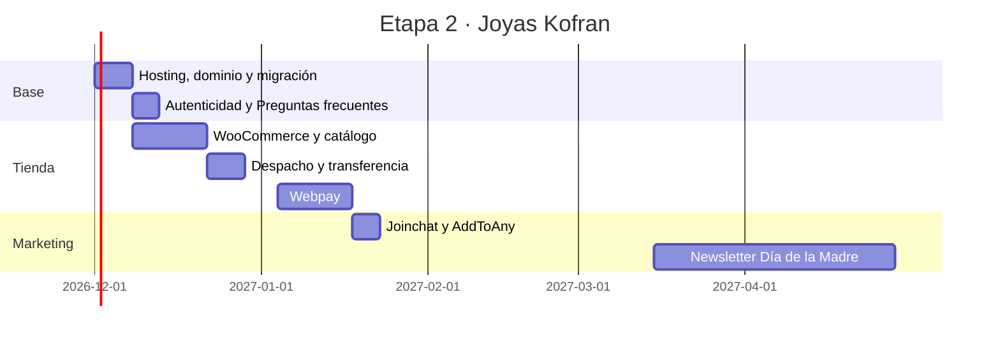

# Plan de continuidad · Etapa 2 de mi sitio

**Emprendimiento:** Joyas Kofran — joyas de plata 925 auténtica, Valparaíso
**Sitio de la etapa 1:** https://joyaskofran.infinityfree.me/
**Fecha:** 23 de noviembre de 2026

En la etapa 1 dejé publicado el sitio con mi tema propio `kofran-joyeria`, las páginas Inicio, Nosotros, Blog y Contacto, 3 entradas, el formulario de contacto, SEO con Yoast y respaldos con BackWPup. La etapa 2 convierte el sitio en una **tienda online**, que era el objetivo principal de mi proto-persona Camila en el Parcial 02 (`docs/03-funcionalidades.md`).

## 1. Qué quedó fuera de la etapa 1 y por qué (3 pts)

| Funcionalidad | Por qué quedó fuera (tiempo, recursos, costo, conocimientos) | Qué aporta a mi emprendimiento |
|---|---|---|
| Tienda con WooCommerce: catálogo, ficha de producto con talla o largo, y carrito | **Recursos y tiempo:** InfinityFree gratis tiene poca memoria y CPU, y WooCommerce es pesado. Además, cargar el catálogo con fotos, precios y stock lleva más tiempo del que tenía | Vender las joyas directamente en el sitio, no solo por Instagram |
| Pago con Webpay o transferencia sin crear cuenta | **Costo y recursos:** la pasarela cobra comisión por venta, pide los datos de un negocio formal y necesita HTTPS estable, que el hosting gratis no garantiza | Que Camila termine la compra con los medios de pago que ya usa |
| Costo y plazo de despacho por comuna, y seguimiento del pedido | **Conocimientos y costo:** hay que conectar un courier (Starken, Chilexpress o Blue Express) o configurar tarifas por zona en WooCommerce | Que la clienta sepa cuánto paga y cuándo llega antes de pagar |
| Páginas Autenticidad de la plata y Preguntas frecuentes | **Tiempo:** prioricé el tema, Contacto y el formulario para el checkpoint y la entrega final | Responder antes de la compra las dudas sobre la plata 925, el cuidado, las tallas y los cambios |
| Botón de WhatsApp por producto (Joinchat) y botones para compartir (AddToAny) | **Tiempo:** quedaron en `decisiones.md`, pero los dejé para cuando exista la ficha de producto, que es donde más sirven | Consultar por una pieza específica sin explicar cuál era, y compartir artículos del blog |
| Newsletter y recordatorios de fechas de regalo | **Conocimientos:** hay que conectar una herramienta de email marketing y cumplir con el consentimiento de datos | Captar contactos y avisar antes del Día de la Madre, San Valentín y Navidad |
| Guía de tallas interactiva y favoritos | **Conocimientos:** necesitan JavaScript o plugins adicionales | Bajar las devoluciones por talla equivocada y recordar las piezas que le gustaron a la clienta |

## 2. Recursos que necesito (2 pts)

| Funcionalidad | Plugin o herramienta | Gratis o de pago | Costo aproximado | Qué tendría que aprender |
|---|---|---|---|---|
| Tienda, catálogo y carrito | WooCommerce | Gratis | $0 | Crear productos con variaciones (talla y largo), categorías, stock e impuestos (IVA) |
| Pago con tarjeta (Webpay) | Plugin oficial de Transbank para WooCommerce | Gratis el plugin; Transbank cobra comisión por venta | Comisión por transacción (revisar las tarifas vigentes de Transbank al contratar) | Afiliar el comercio en Transbank, modo de pruebas y paso a producción |
| Transferencia bancaria | Pago por transferencia (BACS), incluido en WooCommerce | Gratis | $0 | Configurar los datos de la cuenta y confirmar pagos a mano |
| Despacho por comuna | Zonas de envío de WooCommerce o el plugin de un courier chileno | Gratis o de pago según el courier | Según la tarifa del courier | Armar la tabla de tarifas por región y comuna, y generar etiquetas |
| WhatsApp por producto | Joinchat | Gratis (versión Premium de pago) | $0 | Mensaje automático con el nombre de la pieza |
| Compartir en redes | AddToAny Share Buttons | Gratis | $0 | Ubicar los botones en las entradas y en la ficha de producto |
| Newsletter | MailPoet o Brevo | Gratis con límite de envíos | $0 al comienzo | Formularios de suscripción, consentimiento y automatizaciones |
| Correo del formulario y de los pedidos | WP Mail SMTP con Gmail o Brevo | Gratis | $0 | Ya lo configuré en la etapa 1 para el formulario |
| Respaldo fuera del servidor | BackWPup con Dropbox | Gratis | $0 | Conectar Dropbox para que las copias no queden solo en el hosting |

**Servidor:** necesito un **hosting pagado para WordPress** con PHP 8.3 o superior, MySQL o MariaDB, al menos 2 GB de espacio, **certificado SSL (HTTPS) incluido** y más memoria para WooCommerce. También necesito un **dominio propio**, como `joyaskofran.cl`, para que la tienda se vea confiable. El hosting gratis no sirve para una tienda: limita los recursos y el envío de correos, y en ese servidor no conviene manejar pedidos ni datos de clientes.

## 3. Priorización y cronograma (2 pts)

| Prioridad | Qué hago | Cuándo (mes o semana) | Resultado esperado |
|---|---|---|---|
| 1 | Contratar hosting y dominio `.cl`, y migrar el sitio con mi respaldo de BackWPup (pasos del `README.md`) | Diciembre 2026, semana 1 | El sitio funciona en el servidor nuevo con HTTPS |
| 2 | Crear las páginas Autenticidad de la plata y Preguntas frecuentes | Diciembre 2026, semana 2 | Las dudas típicas resueltas antes de abrir la tienda |
| 3 | Instalar WooCommerce y cargar el catálogo inicial (5 categorías: anillos, cadenas y collares, aros, pulseras y dijes) con talla y largo | Diciembre 2026, semanas 2 y 3 | Catálogo navegable con fichas de producto |
| 4 | Configurar el despacho por comuna y el pago por transferencia | Diciembre 2026, semana 4 | Primeras ventas posibles sin pasarela |
| 5 | Afiliar Webpay, probarlo en modo de pruebas y pasarlo a producción | Enero 2027, semanas 1 y 2 | Pago con tarjeta en el sitio |
| 6 | Joinchat en las fichas de producto y AddToAny en el blog | Enero 2027, semana 3 | Consultas por WhatsApp con la pieza ya identificada |
| 7 | Newsletter y campaña del Día de la Madre | Marzo y abril 2027 | Base de contactos y ventas por fechas especiales |

## 4. Riesgos y mitigación (1 pt)

| Riesgo | Qué haría | Cuándo se activa |
|---|---|---|
| La comisión de Webpay o el costo del hosting supera lo que puedo pagar al comienzo | Partir solo con transferencia bancaria y un hosting básico; sumar Webpay cuando haya ventas que lo justifiquen | Si el costo mensual supera mi presupuesto antes de la primera venta |
| La migración al hosting nuevo falla (enlaces rotos, imágenes que no cargan) | Restaurar el respaldo de BackWPup, corregir la URL del sitio y guardar de nuevo los enlaces permanentes; mantener InfinityFree activo hasta que el sitio nuevo funcione | Si después de migrar alguna página da error o faltan imágenes |
| WooCommerce pone lento el sitio | Activar la caché (W3 Total Cache), comprimir las fotos de producto en WebP y volver a medir con Lighthouse | Si el Rendimiento en móvil baja de 70 |
| Un plugin de pago o de envío deja de ser compatible con una actualización de WordPress | Hacer un respaldo antes de cada actualización y probar primero en mi sitio de Local WP | Antes de cada actualización grande |
| Los correos de pedidos llegan a spam o no llegan | Usar SMTP con Brevo o con el correo del dominio y revisar el registro de WP Mail SMTP | Si una clienta avisa que no recibió la confirmación |
| Datos de clientes expuestos | Contraseñas fuertes, un usuario administrador distinto de «admin», HTTPS obligatorio y solo plugins del repositorio oficial | Desde el primer día de la tienda |
